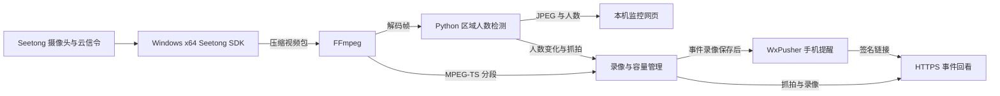

# Seetong 区域监控

预览 Seetong 云端摄像头，在本机检测选定区域的人数，保存抓拍和录像，并通过 WxPusher 发送事件提醒。支持在三路通道中选择一路。可在 Windows、WSL Ubuntu 或 Linux x86_64 上运行。

## 架构与实现



| 模块 | 实现 |
| --- | --- |
| 云取流 | `seetong-login-probe.py` 登录 Seetong 云端，读取设备列表及 P2P 信令配置。原厂 SDK 注册设备，按从 1 开始的通道号订阅视频，媒体回调将压缩包交给 FFmpeg。 |
| Windows 与 Linux | `seetong-monitor.py` 在 Windows 直接加载原厂 SDK。在 Linux 或 WSL 上，它启动 `seetong_wine.py`，由 Wine 内的 Windows x64 Python 加载同一套 DLL。子进程通过标准输入接收连接参数，经带临时令牌的回环 TCP 连接传回视频包。Linux 主进程负责解码、检测、录像和网页，断流时会尝试重连。 |
| 预览与人数检测 | FFmpeg 解码画面，Python 用 ONNX Runtime 运行 YOLOX，合并重复人体框，以人体框底边中心判断人是否在选定区域内。人数稳定约 1 秒后更新，增加时保存带检测框的 JPEG。网页以轮询方式读取预览、人数和事件列表，检测区域按通道保存。 |
| 事件与连续录像 | `seetong_recording.py` 接收 FFmpeg 按原视频编码封装的 MPEG-TS 分段。事件分段先短暂缓存在内存中，区域有人时写入事件文件，清空并经过尾录时间后结束。连续录像可独立开启。两类录像各有磁盘配额，写入前清理相应类型最旧的已保存文件。 |
| 消息与手机回看 | `seetong_alerts.py` 在事件录像保存后向绑定的 WxPusher 设备发送消息。启用 HTTPS 回看时，`seetong_event_share.py` 提供独立的回环服务，按文件名和到期时间校验签名，仅提供该事件的描述、抓拍和视频。首次播放时用 FFmpeg 转成 H.264 MP4，并支持浏览器按字节范围读取和拖动进度。 |

监控网页和控制 API 只监听回环地址。Windows 默认端口为 `8765`，下文 Linux 和 WSL 示例用 `18765`。事件回看使用独立端口 `18766`，只有配置手机访问地址时才开启。录像、截图、区域设置、容量配置和凭据都放在运行时数据目录，默认是 `outputs/seetong-data/`，可用 `--data-dir` 改动。仓库忽略默认数据目录、签名密钥、SDK 副本和模型文件。

## 启动

需要本机安装 Seetong 1.0.12.3、64 位 Python，以及在 PATH 中可用的 FFmpeg。Python 环境需要 `numpy`、`onnxruntime` 和 `Pillow`。

```powershell
python -m pip install numpy onnxruntime Pillow
python .\outputs\seetong-monitor.py
```

也可以双击 `outputs\启动监控.cmd`。浏览器访问 `http://127.0.0.1:8765/`。登录后选择通道并打开预览，在画面里拖出矩形，然后点击「启动检测」。

Windows DPAPI 加密的账号和密码、每路检测区域和截图保存在 `outputs/seetong-data/`。清除已保存的账号可在页面上操作。关闭启动窗口即可停止本机服务。

启动检测后，区域内从无人变为有人会自动保存事件录像。片段会尽量包含触发前约 8 秒的画面，并在确认区域清空后继续录约 2 秒。期间有其他人进入或离开时，录像会持续到区域清空。「区域事件」会显示截图、触发时间和区域人数变化，也可回看或下载相应的录像。

要在手机上接收提醒，安装 [WxPusher](https://wxpusher.zjiecode.com/download/)，在手机 App 的「我的 → SPT」复制令牌。把令牌粘贴到本机监控网页的「手机提醒」，填写设备名称并绑定。列表支持对每个设备发送测试提醒或解绑。每次事件录像保存后，监控服务会向已绑定的接收端推送通道和触发时间。SPT 用 Windows DPAPI 加密保存在 `outputs/seetong-data/`。也可在 WxPusher App 内绑定它支持的微信推送渠道。

配置手机可访问的 HTTPS 回看地址后，提醒会附上单次事件链接，有效期 24 小时。打开链接可看抓拍图和事件录像。已超过存储上限并清理的录像会提示已清理。手机提醒列表中的「测试录像提醒」会把最近一次已保存事件的链接发给所选设备。

打开预览前勾选「同时保存连续录像」，可另外保存所选通道的完整视频，约每 10 分钟分一段。页面顶部「历史录像」可按日期和类型筛选已经保存的片段，并回看或下载。事件与连续录像均在 `outputs/seetong-data/recordings/` 保存为无音频的原画质 `.ts` 文件。「录像存储设置」可分别设置事件视频及截图、普通录像的容量上限，默认分别为 2 GB 和 8 GB。达到上限时先删除该类最旧的已保存文件。

人体检测使用 [OpenCV Zoo YOLOX INT8 模型](https://github.com/opencv/opencv_zoo/tree/main/models/object_detection_yolox)。下载下方的模型文件并保存为 `outputs/seetong-yolox.onnx`。本地取流依赖已安装的原厂 Seetong DLL。

[下载 object_detection_yolox_2022nov_int8.onnx](https://media.githubusercontent.com/media/opencv/opencv_zoo/main/models/object_detection_yolox/object_detection_yolox_2022nov_int8.onnx)

## 固定本地取流依赖

在升级官方客户端前，运行 `python .\outputs\seetong_sdk.py`。它会从本机 Seetong 1.0.12.3 安装复制五个已校验的 DLL 到 `outputs/seetong-sdk/1.0.12.3/`。程序优先加载这份副本，并校验所有文件的 SHA-256。尚未固定时，程序可从同版本的官方安装目录加载。

仓库包含 SHA-256 清单和复制脚本。DLL 文件保存在本机。固定版本可隔离官方桌面客户端升级，取流仍依赖 Seetong 云服务和摄像头固件的兼容性。

## Linux 云服务器

Linux 主进程运行检测、录像、网页和提醒。Seetong 云取流由独立的 Wine 进程加载同一套 Windows x64 SDK，并通过本机回环端口把视频交给主进程。云取流掉线后会自动重连。已在 WSL Ubuntu 24.04.4 x86_64、Wine 9.0 上验证实况取流、检测、录像和重启恢复。部署到云服务器后还需验证服务器网络下的取流和长期运行。

以下命令适用于 Debian 或 Ubuntu x86_64。把项目及本机已校验的 `outputs/seetong-sdk/1.0.12.3/` 和 `outputs/seetong-yolox.onnx` 私下复制到服务器。可同时复制 `seetong-data` 中的 `regions.json` 和 `storage.json`，以保留检测区域和容量设置。Windows 的 DPAPI 凭据需要在 Linux 网页上重新输入。

```sh
sudo apt install python3-venv ffmpeg wine xvfb xauth unzip
cd ~/seetong-monitor
python3 -m venv .venv
.venv/bin/pip install numpy onnxruntime Pillow
```

将 [Python 官网的 Windows embeddable package (64-bit)](https://www.python.org/downloads/windows/) 解压到 `~/seetong-monitor/win-python/`。也可使用 [官方 x64 NuGet 包](https://www.nuget.org/packages/python/3.12.10)，并以解压后的 `tools/python.exe` 替代命令中的 `win-python/python.exe`。Windows Python 只用标准库。若在 WSL 验证，把项目和 SDK 复制到 Linux 文件系统，直接从 `/mnt/c` 加载 SDK 在实测中发生了异常。

```sh
export WINEPREFIX="$HOME/.local/share/seetong-wine"
xvfb-run -a wine "$PWD/win-python/python.exe" "$(winepath -w "$PWD/outputs/seetong_wine.py")" --self-test
xvfb-run -a .venv/bin/python outputs/seetong-monitor.py \
  --wine-python "$PWD/win-python/python.exe" --port 18765 --autostart 1
```

从本机连接服务器时，使用 SSH 隧道。监控网页只监听服务器的回环地址。

```sh
ssh -N -L 18765:127.0.0.1:18765 USER@SERVER
```

访问 `http://127.0.0.1:18765/`。首轮在网页里保存账号并打开预览，确认有画面，再设检测区域和手机提醒。Linux 将账号和 SPT 存为仅服务用户可读写的 `0600` 文件，请使用私有的数据目录。之后 `--autostart 1` 会使用已保存的账号启动第 1 路和普通录像，有已保存的区域及模型时也会启动检测。

验证取流后，可将下面内容保存到 `~/.config/systemd/user/seetong-monitor.service`，由 systemd 管理后台进程。

```ini
[Unit]
Description=Seetong camera monitor

[Service]
WorkingDirectory=%h/seetong-monitor
Environment=WINEPREFIX=%h/.local/share/seetong-wine
ExecStart=/usr/bin/xvfb-run -a %h/seetong-monitor/.venv/bin/python outputs/seetong-monitor.py --wine-python %h/seetong-monitor/win-python/python.exe --port 18765 --autostart 1
Restart=on-failure
RestartSec=10
TimeoutStopSec=25

[Install]
WantedBy=default.target
```

执行 `systemctl --user daemon-reload` 和 `systemctl --user enable --now seetong-monitor`。要让用户服务在退出 SSH 后继续运行，并在重启后随系统启动，需对服务用户执行 `sudo loginctl enable-linger "$USER"`。

### 手机事件回看

给监控程序的启动命令加上 `--share-base-url https://events.example.com`，将域名替换为手机能访问的 HTTPS 站点。事件服务在 `127.0.0.1:18766` 启动，可用 `--share-port` 修改端口。用 [HTTPS 反向代理](https://caddyserver.com/docs/quick-starts/reverse-proxy) 转发该站点的 `/event/*` 请求到事件服务。例如 Caddy 配置如下。

```caddyfile
events.example.com {
    reverse_proxy /event/* 127.0.0.1:18766
}
```

监控后台仍通过原端口和 SSH 隧道访问。请让回看站点的访问日志省略带签名的 URL，并只将链接发给允许看录像的人。链接可在有效期内转发给其他人使用。签名密钥 `event-share.key` 保存在原数据目录里，重启时复用。第一次从手机播放某条录像时会用 FFmpeg 转成 H.264 MP4，进程仅临时缓存最近播放的一条。
